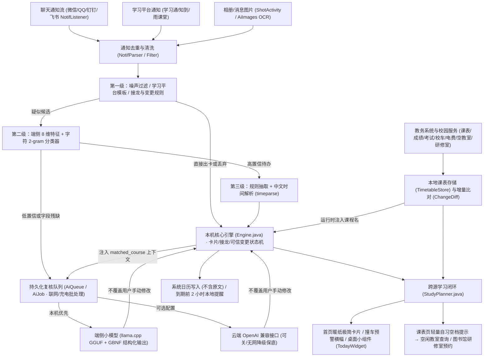
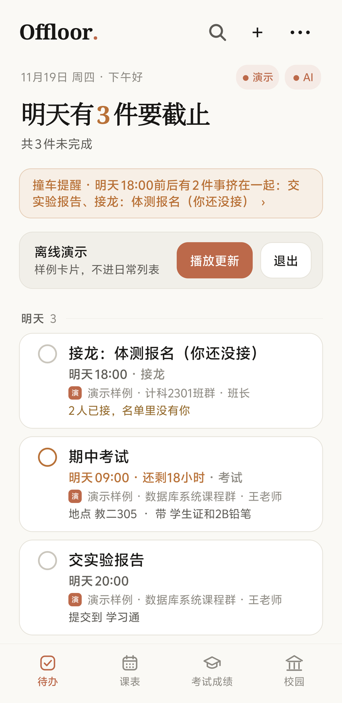
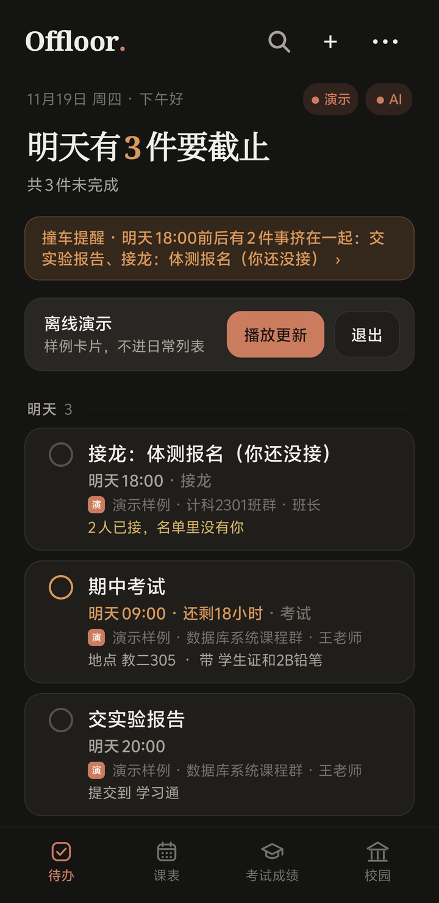
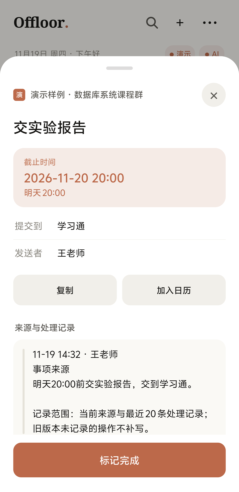

# Offloor「楼外」—— 面向移动终端的端云协同学习生产力助手

> **不再爬楼，人在楼外。**
> 本项目为**第二十届全国大学生软件创新大赛**（赛题方向：**「AI 赋能学习生产力 —— 面向移动终端的场景创新」**）参赛作品，聚焦高校学生面临的多平台群通知过载与学习日程碎片化问题，构建了一套**端侧规则优先、端侧小模型（`llama.cpp` + GBNF）与可选云端按需协同、且深度打通课表与校园空间资源**的原生 Android 客户端与可复现评测体系。

---

## 一、 核心设计思路与赛题契合点

高校学生的日常信息流割裂在**即时通讯群（微信 / QQ / TIM / 钉钉 / 飞书）**、**学习平台（学习通 / 知到 / 雨课堂）**与**校方教务/空间系统**之间，高频痛点集中在四件事：**群通知刷屏漏看作业或接龙、临时改期或撤回难追踪、消息里的时间与课程表割裂、想自习时不知道哪段空档配哪间空教室或研修室**。

**Offloor「楼外」**围绕移动端真实约束给出四层解法：

1. **端侧三级流水线优先，80%+ 消息本地即时消化**：通过系统 `NotificationListenerService` 本地监听通知文字（结合平台模板与截图 OCR 兜底），依次经过**规则噪声过滤 → 8 维特征 + 字符 2-gram 线性分类器 → 结构化抽取/中文时间归一化/接龙与变更状态机**。在无泄漏分布外基准（`eval/strict_ood.jsonl`）上，**81.0%（Java 引擎）~ 86.0%（Python 版）**的消息完全无需调用大模型即可在本机精准出卡或拦截，兼顾零延迟、低功耗与聊天隐私。
2. **端云协同疑难复核 + 课程上下文注入**：仅将低置信度、缺字段或表达含糊的消息写入持久化队列（`AiQueue` / `AiJob`），交由编入 APK 的 **端侧小模型（`llama.cpp` GGUF + GBNF 语法约束 JSON 输出，支持如 Qwen2.5-1.5B Q4_K_M）** 或用户自行配置的 **OpenAI 兼容云端模型** 复核补全。运行时自动将教务课表同步至 `Engine.effectiveProfile()`，并在 [AiClient.java](android/app/src/com/nopalou/AiClient.java) `buildJudgeRequest` 中注入匹配课程名（`matched_course`），辅助模型区分课程作业、通知与无关讨论。
3. **跨源学习生产力闭环（课表 × 待办 × 空教室/研修室）**：[StudyPlanner.java](android/app/src/com/nopalou/StudyPlanner.java) 将教务课表、群通知待办/考试与校园空间系统串联起来——自动检测未来 7 天内**课程时间与截止任务/考试的时间冲突**并在首页预警；在本周课表页（[TimetableActivity.java](android/app/src/com/nopalou/TimetableActivity.java)）结合当日空闲窗口给出轻量自习空档提示，一键预填参数直达**空闲教室查询**（[CampusActivity.java](android/app/src/com/nopalou/CampusActivity.java)）或**图书馆研修室预约**（[StudyRoomActivity.java](android/app/src/com/nopalou/StudyRoomActivity.java)）。
4. **可信归因与严格克制原则**：不替学生「猜时间」——如「3 月中下旬」「下周交」等含糊表述统一保持「待确认」而不编造截止点；仅信任老师/班干等可信来源触发改期或撤卡；卡片详情完整记录原文与处理链路（`TaskTrace` / `TaskChanges`），用户亲手修正的内容永不被 AI 覆盖。

---

## 二、 系统架构



---

## 三、 客户端界面设计

客户端采用自研无第三方重型 UI 框架的原生视图组件体系（`Ui.java` / `CourseUi.java`），`v0.80` 起全面切换为**暖羊皮纸 `#FAF9F5` / 深墨 `#141413` + 素白细描边卡片 + 陶土赤陶 `#C96442`（深色 `#D97757`）单强调色**的极简学习工作台：紧迫度与状态克制区分，全局启用等宽数字（`tnum`）对齐时间与金额，支持浅色 / 深色主题与独立拆分的底部操作面板（[HomeCardSheets.java](android/app/src/com/nopalou/HomeCardSheets.java)、[HomeOpsSheets.java](android/app/src/com/nopalou/HomeOpsSheets.java)）。

| 浅色模式（暖纸主题 · 离线演示） | 深色模式（深墨主题 · 离线演示） | 卡片详情与来源追溯 |
| :---: | :---: | :---: |
|  |  |  |

> 以上三张截图均为 `v0.83` 真机（vivo V2505A · Android 16）在内置「离线演示」模式下的实拍画面，展示撞车提醒、接龙状态追踪、考试/作业卡片与来源轨迹，不含任何真实个人隐私数据。

---

## 四、 核心功能模块

- **消息自动成卡与精准变更追踪**：授权通知使用权后自动整理作业、考试与接龙；同一群 30 分钟内重复推送自动去重；识别带字头及无字头编号名单的「你还没接」群接龙并在本人接龙后自动消卡；区分提问句与真实通知，改期与取消仅响应可信发送者且屏蔽纯星期词误匹配，多场相似考试无法唯一匹配时保留原卡并高亮「待核对」。
- **本机 + 云端协同 AI 识别**：支持 App 内下载或导入 GGUF 模型（通过 `android/native/` + NDK 编译 `llama.cpp`），提供四步配置向导与隐私边界说明；支持按条测试与离线补审旧待确认卡片；相册截图或带图消息支持视觉转写后接入同一识别引擎。
- **按群分级策略、完备溯源与 30 天过期清理**：支持对不同群设置**重点关注**（放宽同学互助消息限制）/ **普通** / **不用管**；支持一键完成（带 4 秒底部撤销条）、移除与已移除列表恢复、手动新建任务卡片，以及每张卡最近 20 条来源与处理记录回溯；启动时自动清理超过 30 天的已完成卡片与已移除记录（未完成待办永不自动删除）。
- **跨源学习闭环与桌面小组件**：课表与待办/考试同屏联动，未来 7 天撞车横幅直达冲突详情；本周课表页提供轻量今日自习空档提示，一键预填参数直达空闲教室或研修室预约；桌面小组件「今日课程与待办」同步展示当下正在上的课与最近截止事项。
- **高校教务与校园服务深度适配**：支持西北工业大学自动续登（凭据经 Android Keystore + AES-GCM 加密本地存储）、周课表（支持友谊校区夏/冬季作息）、成绩跨学期检索、待考日程一键复制、50 条官方校车未发车筛选、宿舍电费/校园网/一卡通余额同步与低余额阈值提醒（缴费跳转官方页，绝不代收卡密）、校园服务设置内「复制同步自检」脱敏诊断报告，以及图书馆研修室合规预约（绝不后台抢约、绝不绕过验证码、写操作不自动重试）；课表模块亦预留太原理工、陕师大、哈工大（威海）适配测试入口。

---

## 五、 评测体系与实测结果

为避免合成数据模板泄漏带来的虚假高分，本项目同时维护**两套评测基准**并开源可一键复现的对比脚本：

### 1. 严格无发送者标签泄漏 · 现实分布外评测（100 条）

评测集 [eval/strict_ood.jsonl](eval/strict_ood.jsonl) 包含 100 条全新人工构造的多样式现实消息（覆盖作业、考试/答辩、多维口语与跨年截止时间、含糊时间克制 10 条、群接龙、停课调课通知、提问/第一人称/闲聊干扰等，**不以答案标签反推发送者**），由 `python eval/run_benchmark.py` 驱动并输出完整 JSON 至 [eval/benchmark_report.json](eval/benchmark_report.json)：

| 实验方案 | 召回 (Recall) | 精确 (Precision) | F1 | 截止时间准确 | 模糊时间克制 | 接龙召回 | 纯本机未上云比例 |
|---|---|---|---|---|---|---|---|
| 基线：仅关键词规则 (`keyword_only`) | 70.0% | 72.9% | 71.4% | 65.0% | 100.0% | 80.0% | 100.0% |
| 消融：仅 Stage 2 线性模型 (`stage2_lr_no_rules`) | 20.0% | 100.0% | 33.3% | 25.0% | 100.0% | 100.0% | 100.0% |
| **Python 三级流水线（混合真实发送者）** | **94.0%** | **97.9%** | **95.9%** | **90.0%** | **100.0%** | **100.0%** | **86.0%** |
| **APK Java 引擎（混合真实发送者）** | **94.0%** | **97.9%** | **95.9%** | **90.0%** | **100.0%** | **100.0%** | **81.0%** |
| 敏感性分析（Python）：发送者全设为老师 | 98.0% | 87.5% | 92.5% | 95.0% | 100.0% | 100.0% | 80.0% |
| 敏感性分析（Python）：发送者全设为学生 | 64.0% | 88.9% | 74.4% | 60.0% | 100.0% | 100.0% | 83.0% |

> **关键观察**：在剔除发送者泄漏后，本机规则 + 分类器协同相较单纯关键词基线将 F1 从 **71.4%** 提升至 **95.9%（Python 与 APK Java 双端持平）**；APK Java 引擎实际有 **81.0%**（`Engine.escalator` 触发 19/100 条，含未出卡边界样本）无需大模型即可在本机完成判定（Python 侧 `86.0%` 为基于已出卡 `needs_confirm`/低置信的估算），且两端对 10/10 条含糊时间与 10/10 条群接龙均保持 **100%** 表现。

### 2. 合成时间切分留出集与 Java / Python 双端一致性对照（8,086 条）

按时间顺序取最后 30%（8,086 条）合成消息、在同一演示档案下直接对比 APK 实际运行的 `Engine.java` 与 Python `pipeline.py`（由 `python eval/run_java_eval.py` 生成）：

| 引擎 | 待办召回 | 待办精确 | F1 | 截止时间准确 | 未见过待办召回 | 接龙召回 / 精确 |
|---|---|---|---|---|---|---|
| **Java（APK 实跑引擎）** | 98.89% | 95.97% | 97.41% | 93.25% | 98.94% | 100% / 100% |
| **Python（参考实现）** | 99.72% | 96.00% | 97.83% | 92.40% | 100.0% | 100% / 100% |

> **可信度诚实说明**：上述 8,086 条合成留出集中有 **82.32%** 的文本在训练集出现过（其中 `notice` 97.87%、`discussion` 和 `chatter` 达 100%），合成数据上的极端模板不可用于衡量真实群聊泛化，这也是本项目专门新增 `strict_ood.jsonl` 严谨基准的原因；此外，真实大学班级群聊上的端到端线上标注准确率与端侧 1.5B 小模型在不同中低端机型上的实测耗时/耗电仍需进一步真机采集补充。

### 3. 工程回归与可靠性校验

- **核心与适配器全量校验**（`python eval/run_checks.py --android-jar ... --json-jar ...`）：**95 组检查、0 组失败**（免 Android SDK 运行 78 组；传入 jar 跑满 95 组，覆盖 `EngineTest`、`Step3~Step65` Java 引擎及跨源学习闭环/课表/校园/AI 适配器测试，以及时间解析、撤回规则、考试边界、去重排序、`test_strict_benchmark` 等 16 项 Python 脚本）。
- **页面与校园服务契约回归**（`python eval/run_browser_checks.py`）：**19 组检查、0 组失败**（覆盖首页视觉 `test_home_visual.cjs`、用户须知 `test_home_usage_notice.cjs`、校园网/一卡通余额同步 `test_campus_balance_sync.cjs`、课表导入、电费/空教室、校车与图书馆研修室等 19 项浏览器/节点脚本）。
- **状态持久性、有状态序列与演示回放**：`python eval/run_reliability.py`（20/20 边界分支全过）、`python eval/run_sequence_eval.py --require-stateful-pass`（主序列与 `exam_cancel_review_cases.json` 双端全过）、`python eval/run_showcase.py`（3 条演示分支各 7 态完整导出）。
- **端侧 1.5B 小模型与核心链路真机实测（2026-11-19，vivo V2505A · Android 16 · arm64-v8a）**：已加载 `Qwen2.5-1.5B-Instruct Q4_K_M`（`1.04 GB`）并实跑 `liboffloor_llm.so` + GBNF 试跑，**冷加载试跑耗时 `2.927 秒`、页缓存温态 `2.357 秒`**；进程 PSS 内存 `251.4 MB → 1.79 GB 峰值 → 256.8 MB`（推理结束自动即时释放约 `1.58 GB`，无泄漏），电池温度 `34.8°C → 34.8°C`，校园三栏余额（`¥` 统一格式）、课表空档直达空教室/研修室与通知监听保活均实机验证通过（`0` 崩溃 / `0` ANR；中低端机型耗时、多批耗电及 1.5B vs 云端同集质量对照仍待补充）。

---

## 六、 项目目录结构

```text
Offloor/
├── data/
│   ├── synthesize.py                 # 合成群聊数据生成器（用于基线对比与回归验证）
│   └── dataset.jsonl                 # 生成的带标注多日消息序列
├── engine/
│   ├── timeparse.py                  # 中文复杂时间表达式归一化（含糊则标待确认）
│   ├── features.py                   # 8 维手工特征 + 字符 2-gram（训练/端侧一致）
│   ├── extract.py / jielong.py       # 待办/考试结构化抽取与接龙状态追踪
│   ├── pipeline.py                   # Python 三级识别编排与规则状态机
│   └── model.json / model.tsv        # 同步至 APK 端侧的分类器权重
├── eval/
│   ├── strict_ood.jsonl              # 100 条无发送者泄漏的严格现实分布外评测集
│   ├── run_benchmark.py              # 多基线对比 + Java/Python OOD + 泄露审计脚本
│   ├── test_strict_benchmark.py      # 严格基准自动化回归断言
│   ├── train.py / run_eval.py        # 分类器训练与合成集留出/消融评测
│   ├── run_java_eval.py / EngineEval.java  # APK Java 引擎评测与复核率统计
│   ├── run_checks.py                 # 95 组 Java + Adapter + Python 全量校验入口
│   ├── run_browser_checks.py         # 19 组校园/首页浏览器与页面脚本回归入口
│   ├── run_sequence_eval.py / run_reliability.py / run_showcase.py  # 有状态序列、边界可靠性与演示状态机导出
│   └── test_*.py / test_*.cjs / time_cases.tsv  # 专项回归脚本（含首页视觉/弹窗/校园余额同步测试）
├── android/
│   ├── app/src/com/nopalou/          # 原生 Android 源码（无重型第三方框架）
│   │   ├── Engine.java               # 核心状态机、课表课程同步、接龙/变更/考卡与 30 天清理
│   │   ├── StudyPlanner.java         # 跨源撞车检测、自习空档计算与课程上下文匹配
│   │   ├── AiClient.java / LocalLlm*.java / AiJob.java  # 端云协同 AI 复核与 GBNF 输出
│   │   ├── HomeCardSheets.java / HomeOpsSheets.java     # 拆分的首页详情与运维面板
│   │   ├── Campus*.java (含 CampusPortalScan / CampusDiag) / StudyRoom*.java / Timetable*.java / Academic*.java
│   │   └── TodayWidget.java / NotifListener.java / MainActivity.java ...
│   ├── native/                       # llama.cpp JNI 封装与端侧 GGUF 编译配置
│   ├── replay/                       # 独立通知回放器 APK（272 条离线链路演示）
│   ├── test/                         # Step3~Step65、CampusDataTest、TimetableTest、AiResponseTest 等 JVM 用例
│   └── build.py / prepare_updates.py # 跨平台零 Gradle 构建脚本与更新清单校验
├── docs/                             # 设计文档、真机记录、规则说明与 UI 重构截图
├── .github/                          # CI 自动检查与预览版/正式版带 NDK APK 构建流
├── CHANGELOG.md                      # v0.9 ~ v0.83 完整版本演进与候选分支记录
└── README.md                         # 本文件
```

---

## 七、 快速开始（构建与复现评测）

### 1. 复现算法评测与全量自测（仅需 Python 3.9+ / JDK 17+ / Node.js）

```bash
# 1. 运行严格无泄漏 OOD 多基线基准对比（输出 eval/benchmark_report.json）
python eval/run_benchmark.py

# 2. 运行全量核心回归与严格基准校验（免 Android SDK 运行 78 组；传入 jar 后跑满 95 组）
python eval/run_checks.py
# 若本地已有 android.jar 与 org.json.jar：
# python eval/run_checks.py --android-jar <android.jar> --json-jar <org.json.jar>

# 3. 复现 APK Java 引擎 vs Python 一致性对照（8,086 条）
python eval/run_java_eval.py --out java-comparison.json

# 4. 运行边界可靠性、有状态序列与 19 组页面/浏览器回归
python eval/run_reliability.py --out reliability.json
python eval/run_sequence_eval.py --require-stateful-pass --out sequence.json
python eval/run_browser_checks.py
```

### 2. 构建 Android 安装包

需要 JDK 17+、Python 3.9+、Android SDK（Platform 34 与 Build Tools 34.0.0）；若需编入端侧 `llama.cpp` SO 库需另配 Android NDK 与 CMake（仅验证 UI 与常规链路可加 `--no-native`）：

```bash
# 设置 ANDROID_HOME 或通过 --sdk 指定路径，生成预览版 APK
python android/build.py --sdk <Android SDK 路径> --preview --no-native

# 安装到真机（Android 7.0+，无需开启通知权限即可使用「离线演示」）
adb install -r android/build/nopalou-preview.apk

# 可选：授予通知读取权限用于实机通知链路测试
adb shell cmd notification allow_listener com.nopalou/com.nopalou.NotifListener
```

> 评审无需物理手机也可通过 `node eval/run_test.mjs Step61Test` / `Step12Test` 等 JVM 独立单测直接验证引擎、跨源学习闭环与演示分支逻辑；带完整 NDK 原生推理库的包可通过仓库 GitHub Actions CI 自动构建。

---

## 八、 隐私合规、安全边界与当前局限

1. **最小权限与纯本机优先**：通知解析严格限制在系统实际弹出的通知文字范围内，不读取聊天数据库、不使用无障碍（AccessibilityService）强行爬屏；免打扰折叠消息、历史未显示记录与微信/QQ 语音文件不会越权读取（可用相册截图 OCR 主动补充）。
2. **凭据、清理与写操作安全**：教务登录账号密码使用 Android Keystore + AES-GCM 加密保存在本机；启动时自动清理 30 天前的已完成与已移除记录（未完成待办保留）；校园同步自检报告默认脱敏，不包含学号、余额数字、姓名、密码或临时令牌；写入系统日历时不写入群消息原文，防止系统日历云同步外泄隐私；图书馆研修室不进行后台抢约、不绕过校方验证码、写请求不自动重试；水电/网费充值仅跳转校方官方页面，不代收代扣、不保存任何支付卡号与密码。
3. **现存已知局限**：国产定制系统（如部分机型后台限制）在重启后可能挂起通知监听，App 已内置自启动/电池白名单引导与看门狗重连；多校课表适配（除西工大外）及端侧小模型在中低端机上的分机型耗时基准仍有待进一步真机实测补充。

---

详见 [完整版本更新日志（CHANGELOG.md）](CHANGELOG.md)。
