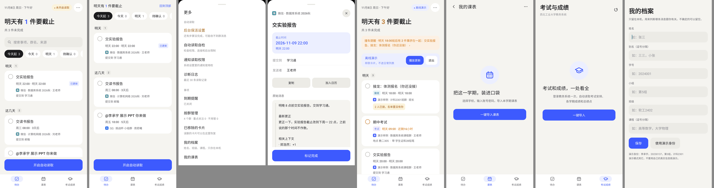
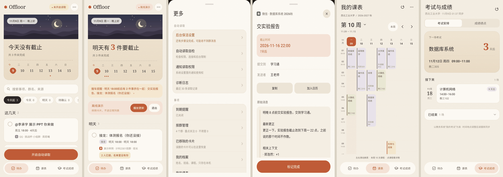
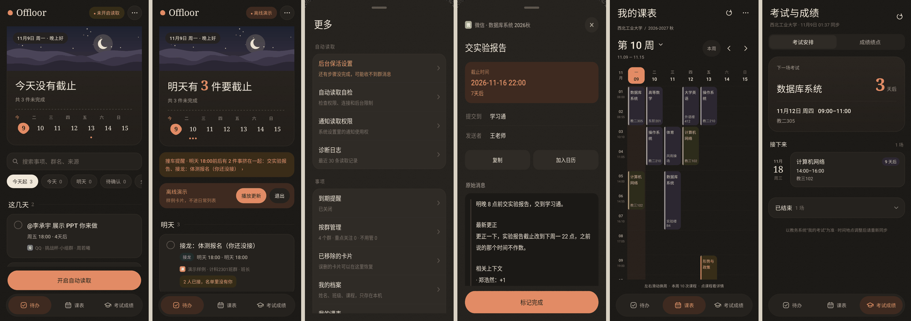
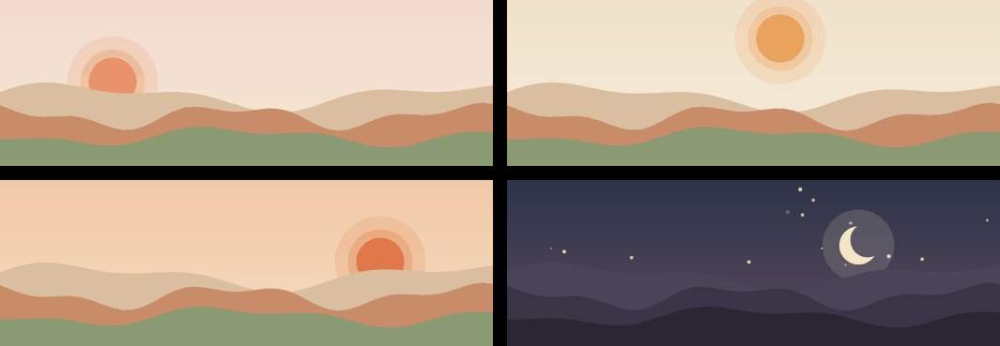

# 界面重构 v0.21「纸与陶」

一本手边的旧笔记本。暖调羊皮纸做底、带一点几乎看不见的纸纹；米白卡片像夹进本子里的便笺；
标题和数字用衬线体，读起来像排过版的书页；唯一的强调色是烧制过的陶土色。
首页顶部是一幅随时辰变化的小风景，让一个“管作业”的工具有一点温度。

| 重构前（v0.19） | 重构后 · 浅色 | 重构后 · 深色 |
|---|---|---|
|  |  |  |

首页风景的四个时段（清晨 / 午后 / 傍晚 / 夜里），浅色与深色：

截图来自无界面渲染（Robolectric 原生绘制，393×852dp），数据是回放器里的 271 条样例群消息。
渲染环境里没有衬线中文字体，所以截图中的中文标题仍是无衬线；真机（Android 8+ 自带 Noto Serif CJK）上会是宋体风格。

## 设计语言（`Ui.java`）

- **纸**：页面底色 `#F4EEE3`（深色 `#1B1916`），叠一层固定种子生成的细点纸纹（透明度 3%～6%）。主页面、底部面板、导航都透出这张纸。
- **陶土**：强调色 `#BF5B37`（深色 `#E28B65`），主按钮、选中态、「今天」都用它；主按钮是全圆角胶囊。
- **语义色**：红 / 橙 / 琥珀仍只表达时间压力，紫 / 青只表达卡片类型，绿表示完成，全部调成低饱和的矿物色，和纸放在一起不刺眼。
- **便笺卡**：米白卡 + 一圈 0.8dp 暖色细线，只垫极轻的暖棕投影。
- **衬线**：`Ui.serif()` 用于字标、大标题、分组名、日期数字、倒计时；正文仍是无衬线。
- **手作形状**：`Ui.blob()` 由贝塞尔曲线拼成、边缘微微起伏的圆团，替代几何正圆（字标前的小印、「今天」的日期底、空状态图标底）。
- **风景**：`Ui.scenery(hour)` 纯色块叠出的远山、近丘和一轮日头；日头沿弧线随钟点移动，夜里换成新月和星星。时段切换时自动重画。

## 各页面

- **待办**：衬线字标 `Offloor` + 陶土小印；「今日概览」是一张明信片——上半幅风景，日期压在画上；下半是衬线大字结论（数字放大、加粗、带语义色）、虚线裁切线、未来七天截止分布。分组标题改为衬线栏目名 + 延伸细线；搜索框与筛选胶囊改为便笺式描边。
- **更多 / 详情面板**：纸纹面板、衬线标题，「更多」按用途分组、行尾箭头，危险操作单独成组。
- **底部导航**：悬浮胶囊，选中项衬陶土浅底。
- **课表**：衬线大标题；课程色换成一组矿物颜料（陶土、苔绿、赭石、藕灰、豆沙、橄榄）。
- **考试成绩**：「下一场考试」改为暖沙卡纸 + 衬线课程名 + 陶土色大号倒计时。
- **空状态**：陶土色手作圆团 + 衬线标题。

## 没改什么

所有交互、数据流、文案、筛选逻辑、动画保持原样；引擎和测试不受影响（`EngineTest` 19/19 通过）。
