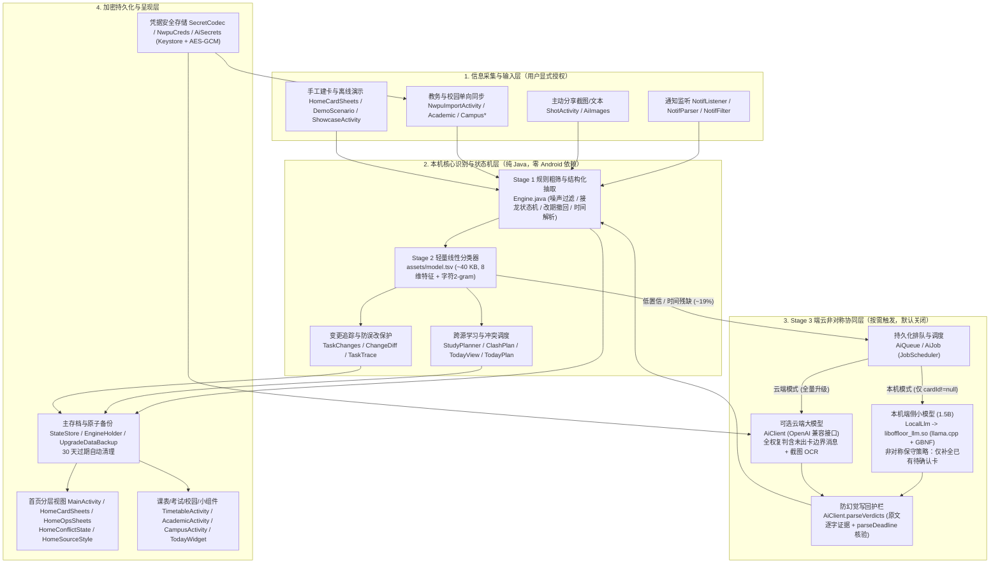

# Offloor「楼外」系统架构与模块说明（v0.86）

> 本文档面向软件工程评审与代码审查，完整说明系统的分层架构、端侧三级识别与端云协同数据流、核心模块职责边界、持久化与隐私安全设计及自动化测试体系。

## 1. 整体分层架构

Offloor 采用**零重型第三方框架、纯原生 Android（Java 11）+ 原生 C++ JNI（`llama.cpp`）**的轻量分层架构：全应用共 `109` 个生产 Java 类（约 `25.6k` LOC）与 `1` 个 `227` 行 C++ JNI 封装，最终含端侧小模型推理库的签名 APK 仅约 **`2.46 MB`**。

---

## 2. 核心设计原则与技术边界

1. **核心算法层与 Android 框架彻底解耦**：
   - `Engine`、`StudyPlanner`、`ClashPlan`、`TodayView`、`TodayPlan`、`TaskChanges`、`ChangeDiff`、`StateFormat`、`SectionTimes`、`HomeConflictState`、`LocalLlmCore`、`AiQueueCore`、`AiBudgetCore`、`CampusDiag` 等全部不依赖 `android.*` UI 类，可在标准 JVM 上毫秒级独立编译并执行 95 组回归单测与同集算法评测。
2. **双端评测一致性**：
   - Python 参考实现（`engine/*.py`）用于数据生成、特征探索与模型训练（输出 `model.tsv`）；APK 实际运行的 `Engine.java` 直接加载同一权重并在严格分布外集与 8,086 条留出集上保持逐项对齐。
3. **三道防幻觉与用户主权护栏**：
   - **采样阶段（GBNF 语法约束）**：`LocalLlmCore.judgeGrammar(n)` 在 `llama.cpp` 采样阶段强制锁死输出 JSON 结构、条目序号与日期格式，将 1.5B 模型有效结构化输出率由 `5.3%` 提升至 `100.0%`。
   - **解析阶段（原文证据核验）**：`AiClient.parseVerdicts` 要求时间必须与本机确定性解析或原文逐字 `deadline_evidence` 吻合，地点/渠道/携带物必须源自原文片段，将含糊时间胡编率压至 `0%`。
   - **写回阶段（非对称权限与人工主权）**：`v0.86` 起端侧小模型仅允许补全已有待确认卡片（禁止凭空新建待办，在 `AiJob` 侧提前跳过以省电），且用户手动修改过的标题/时间、已完成卡片及待核对变更记录永不被 AI 覆盖。

---

## 3. 核心模块职责清单

| 分层 | 代表文件 | 行数（v0.86） | 核心职责 |
|---|---|---:|---|
| 核心识别状态机 | `Engine.java` | 3,499 | 三级流水线编排、中文时间归一化、接龙追踪、改期/撤回/歧义保护、30 天自动清理 |
| 跨源日程规划 | `StudyPlanner.java` / `ClashPlan.java` | 290+ | 考试持续时长区间重叠撞课检测、7 天相近任务撞车聚合、课表自习空档计算与课程上下文匹配 |
| 变更与溯源 | `TaskChanges.java` / `ChangeDiff.java` / `TaskTrace.java` | 400+ | 字段级差异对比、多目标歧义拦截（转「待核对」）、最近 20 条处理轨迹记录 |
| 端云协同 AI | `AiClient.java` / `AiJob.java` / `AiQueue.java` / `LocalLlmCore.java` | 1,100+ | 批处理队列、`JobScheduler` 调度、端侧 GBNF 语法生成、防幻觉解析与非对称权限护栏 |
| 原生推理库 | `android/native/offloor_llm.cpp` | 227 | `llama.cpp`（`v0.9.0 / cd959ba`）最小 JNI 封装，UTF-8 字节数组传输、贪心采样 + 按需语法过滤 + 线程安全取消 |
| 首页视图分层 | `MainActivity.java` | 2,030 | 首页生命周期、编辑风概览、四段胶囊筛选、轻薄两行分组列表渲染与完成动效 |
| 首页卡片交互 | `HomeCardSheets.java` | 534 | 卡片详情与来源溯源、冲突明示、手动新建/编辑表单、系统日历写入（不含群原文） |
| 首页运维设置 | `HomeOpsSheets.java` | 725 | 自动读取自检、诊断日志、历史通知扫描、存档状态、二级菜单与按群/已移除管理 |
| 首页冲突协调 | `HomeConflictState.java` | 133 | 零 Android 依赖的冲突索引与摘要/详情文案生成（彻底替代顶部跳动横幅） |
| 来源样式缓存 | `HomeSourceStyle.java` | 136 | `Drawable.ConstantState` 安全图标缓存、缺失记忆与多平台品牌色徽标 |
| 课表与学业 | `TimetableActivity.java` / `AcademicActivity.java` / `NwpuImportActivity.java` | 1,890+ | 西工大教务课表/考试/成绩同步、往周柔化渲染、本周自习空档直达空教室/研修室 |
| 校园便捷服务 | `CampusActivity.java` / `StudyRoomActivity.java` / `CampusDiag.java` | 2,900+ | 电费/网费/一卡通统一 `¥` 余额、校车时刻、空教室与合规研修室预约、零隐私脱敏同步自检 |
| 安全与存储 | `SecretCodec.java` / `StateStore.java` / `UpgradeDataBackup.java` | 600+ | Android Keystore + AES-GCM 凭据加密、原子写入与损坏自动回退备份 |

---

## 4. 质量保证与可复现工程验证

| 验证套件 | 命令入口 | 覆盖规模 | 当前状态 |
|---|---|---|---|
| 核心 + 适配器单测 | `python eval/run_checks.py --android-jar ... --json-jar ...` | **95 组**（Java 引擎/AI/课表/校园 + 16 项 Python 脚本） | **95 / 95 通过** |
| 页面与视觉契约 | `python eval/run_browser_checks.py` | **19 组**（首页视觉、使用须知、校园解析/余额同步） | **19 / 19 通过** |
| 多轮有状态序列 | `python eval/run_sequence_eval.py --require-stateful-pass` | **30 场景 / 39 检查点**（对比有状态 vs 逐条抽取） | **30 / 30 通过** |
| 严格无泄漏 OOD + 大模型对照 | `python eval/run_benchmark.py` & `eval/run_llm_comparison.py` | 100 条冻结集 × 8 组方案 + GBNF 消融 | 已冻结落盘 |
| 持续集成与自动构建 | `.github/workflows/` | 每次推送自动跑核心回归 + NDK 编译 `liboffloor_llm.so` + 发布签名 APK | 自动绿灯发布 |
